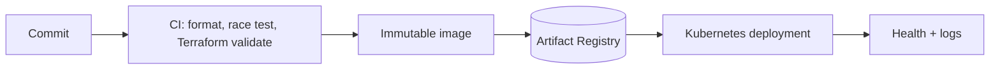

# Platform Blueprint

[](https://github.com/borikhan/platform-blueprint/actions/workflows/ci.yml)
[](https://go.dev/)
[](https://www.terraform.io/)

A secure delivery blueprint for a twelve-factor Go service: application code, health semantics, non-root container, Kubernetes runtime policy, Terraform-managed artifact registry, and least-privilege CI in one reviewable repository.

## What this demonstrates

- Separate liveness and readiness signals with release metadata
- Multi-stage container that runs as an unprivileged user
- Read-only root filesystem, dropped Linux capabilities, and bounded resources
- Declarative Kubernetes deployment and service
- Version-constrained Terraform validated in CI
- Environment-owned configuration and structured logs



## Verify locally

```bash
go test -race ./...
terraform -chdir=infra init -backend=false
terraform -chdir=infra validate
docker build -t platform-blueprint .
```

This is a reference baseline, not a claim that one manifest solves every platform. Read [architecture and operations](docs/architecture.md) for release flow, security choices, production gaps, and the complete twelve-factor mapping.

## License

MIT
